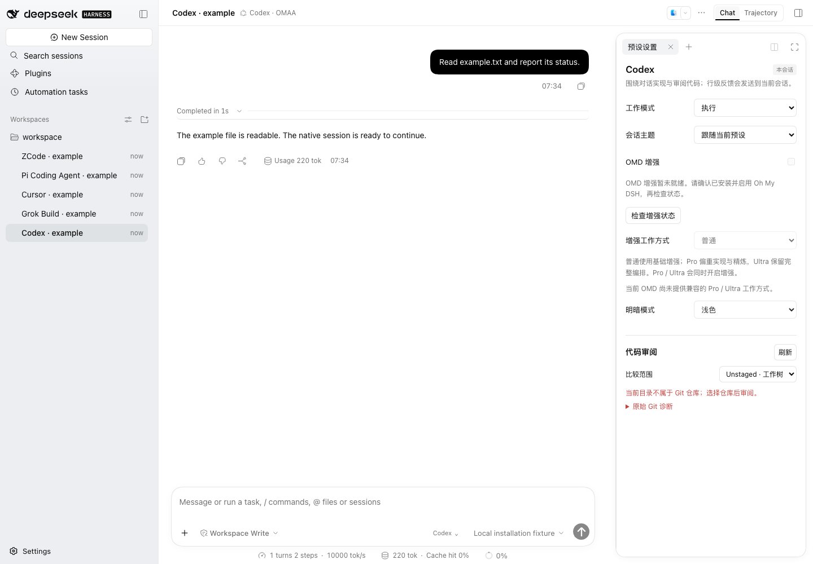

<a name="readme-top"></a>

<h1 align="center">Oh My Agents Above All</h1>

<p align="center"><strong>在 DSH 里用上 Codex、Grok Build、Cursor、Pi 和 ZCode 的工作方式，模型还是你自己的。</strong><br>DeepSeek Harness 插件</p>

<p align="center"><strong>简体中文</strong> · <a href="README_EN.md">English</a></p>

<p align="center">
  <a href="https://github.com/gulagala001/oh-my-agents-above-all/releases/latest"></a>
  <a href="https://github.com/gulagala001/oh-my-agents-above-all/releases"></a>
  <a href="#readme-install"></a>
  <a href="https://github.com/gulagala001/oh-my-agents-above-all/stargazers"></a>
</p>

<p align="center"><a href="#readme-install"><strong>开始使用</strong></a> · <a href="docs/frontend-workbench.md">使用指南</a> · <a href="https://github.com/gulagala001/oh-my-agents-above-all/issues">反馈</a></p>

<p align="center"><a href="docs/images/frontend-015/codex-light.png"><picture><source media="(prefers-color-scheme: dark)" srcset="docs/images/frontend-015/codex-dark.png"></picture></a></p>

<a name="readme-install"></a>

## 快速开始

**需要：** DSH **0.2.2-rc.2**，Node.js **24.9.0+**。用的是 DSH 里已经配好的模型和密钥。

### 1. 安装

在 DSH 里打开 **插件 → ＋ 添加插件**，粘贴：

```text
https://github.com/gulagala001/oh-my-agents-above-all/releases/download/v0.2.2-rc.2.omaa.0.17.11/oh-my-agents-above-all-0.2.2-rc.2.omaa.0.17.11.tgz
```

等手头的任务跑完，按提示完整重启 DSH，原来的设置和会话都还在。命令行安装、升级和卸载见[安装指南](docs/install.md)，校验文件：[SHA256SUMS](https://github.com/gulagala001/oh-my-agents-above-all/releases/download/v0.2.2-rc.2.omaa.0.17.11/SHA256SUMS)。

### 2. 开启一个预设

预设默认全部关闭，装好后 DSH 没有任何变化。打开 **设置 → OMAA**，开启想用的预设，然后新建会话，选 **Codex · OMAA** 或其他预设，输入：

```text
只读检查这个项目的 README 和目录结构，列出开始开发前需要确认的事项。
```

会话会换上这个预设的工作方式和主题，用 DSH 的工具读出项目的实际内容。

## 五个预设

模型、工具、会话和权限都还是 DSH 的。预设换的是 AI 的工作方式、工作台和界面，不需要装五个官方客户端。

| 预设 | 适合做什么 |
| --- | --- |
| **Codex** | 连续写代码：审阅 Git 改动，按文件或代码块暂存和撤回，行批注，跳到本机编辑器，批量反馈让 AI 接着改 |
| **Grok Build** | 先计划再执行：实时看命令输出，定时任务，可排序、可插话的消息队列 |
| **Cursor** | 按项目规则干活：读 `.cursor/rules`，Ask 和 Plan 模式，代码审阅，改坏的文件可以按检查点恢复 |
| **Pi** | 精简可控：工具少，能逐条插话，会话分支随时切换，可以接你自己写的本地扩展 |
| **ZCode** | 可复用的工作流：用对话发起，看执行图和产物，保存后按名字再跑 |

每个会话的主题可以跟随预设、换成另一个预设的，或者用 DSH 默认外观，深浅色跟随 DSH。用法见[使用指南](docs/frontend-workbench.md)。

## 使用范围

- 用不到这五个产品的官方账号或云端服务，也不会登录它们。
- Cursor 检查点只记录 AI 用写入和编辑工具改过的文件，终端命令改的文件不在内。
- Pi 分支共用同一个工作目录，切换分支不会回退文件。
- Pi 本地扩展默认一个都不启用，只运行你在设置里明确加入的文件。

## 常见问题

<details>
<summary>换了预设，模型怎么没变？</summary>

预设只改工作方式和主题，模型还是在 DSH 的模型选择里换。选一个支持工具调用的模型效果更好。

</details>

<details>
<summary>能用原产品的账号或云端功能吗？</summary>

不能。OMAA 用的是 DSH 的模型和密钥，不会登录或代理这五个官方客户端。每个预设能做什么见[使用指南](docs/frontend-workbench.md)。

</details>

<details>
<summary>升级或卸载会删会话吗？</summary>

不会。升级沿用原来的 profile 和数据。卸载也不会删 DSH 会话和工作区文件；偏好、检查点和 Pi 扩展白名单在 `DSH_HOME/omaa`，会留着。见[安装指南](docs/install.md)。

</details>

## 开发和许可

[贡献说明](CONTRIBUTING.md) · [架构](docs/architecture.md) · [来源资料](docs/product-sources.md)

原创代码用 [Apache-2.0](LICENSE) 许可。第三方代码和材料保留各自的许可和署名，Cursor 样本的授权范围尤其要注意，见 [LICENSING.md](LICENSING.md) 和 [THIRD_PARTY_NOTICES.md](THIRD_PARTY_NOTICES.md)。

反馈问题请写明 DSH 和插件版本、用的哪个预设、操作步骤、期望和实际结果，日志和截图先去掉个人信息：[Issues](https://github.com/gulagala001/oh-my-agents-above-all/issues)。
