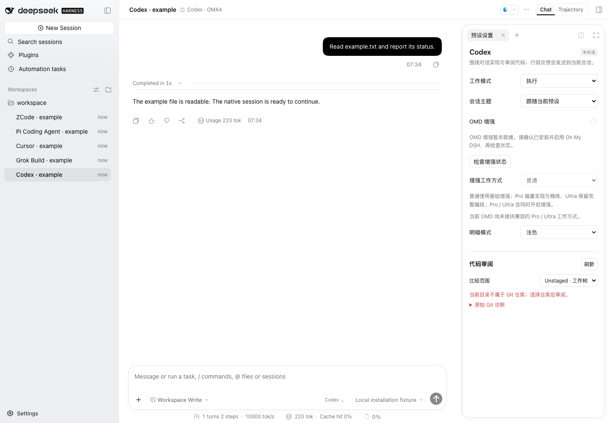

<a name="readme-top"></a>

<h1 align="center">Oh My Agents Above All</h1>

<p align="center"><strong>在 DSH 中选择五种不同的代理工作方式。</strong><br>DeepSeek Harness 插件</p>

<p align="center"><strong>简体中文</strong> · <a href="README_EN.md">English</a></p>

<p align="center">
  <a href="https://github.com/gulagala001/oh-my-agents-above-all/releases/latest"></a>
  <a href="https://github.com/gulagala001/oh-my-agents-above-all/releases"></a>
  <a href="#readme-install"></a>
  <a href="https://github.com/gulagala001/oh-my-agents-above-all/stargazers"></a>
</p>

<p align="center"><a href="#readme-install"><strong>开始使用</strong></a> · <a href="docs/frontend-workbench.md">完整文档</a> · <a href="https://github.com/gulagala001/oh-my-agents-above-all/issues">反馈</a></p>

<p align="center"><a href="docs/images/frontend-015/codex-light.png"><picture><source media="(prefers-color-scheme: dark)" srcset="docs/images/frontend-015/codex-dark.png"></picture></a></p>

<a name="readme-install"></a>

## 快速开始

**适用环境：** DSH **0.2.1-rc.3**, Node.js **22.19+**.

使用 DSH 已配置的模型与凭据。五个预设提供来源提示词、工作流程和主题适配，不附带对应产品的官方账号或专有云端服务。

### 1. 安装

打开实际使用的 DSH 实例，在 **插件 → ＋ 添加插件** 中粘贴：

```text
https://github.com/gulagala001/oh-my-agents-above-all/releases/download/v0.2.1-rc.3.omaa.0.17.6/oh-my-agents-above-all-0.2.1-rc.3.omaa.0.17.6.tgz
```

等当前任务结束后，按宿主提示启用或完整重启该实例，沿用原 profile 与数据。其他宿主、升级和卸载见[安装指南](docs/install.md) · [SHA256SUMS](https://github.com/gulagala001/oh-my-agents-above-all/releases/download/v0.2.1-rc.3.omaa.0.17.6/SHA256SUMS).

### 2. 先试这一件事

默认关闭全部预设。先到 **设置 → OMAA** 按需开启，再在新会话中选择；不会替换宿主默认预设，全部关闭时会话、工具和主题保持原样。

新建会话，选择 **Codex · OMAA** 或其他预设，输入：

```text
只读检查这个项目的 README 和目录结构，列出开始开发前需要确认的事项。
```

**成功标志：** 会话使用所选预设的工作方式与主题，并通过 DSH 原生工具返回实际项目内容。

## 五种工作方式，共用你的 DSH 环境

OMAA 为 Codex、Grok Build、Cursor、Pi Coding Agent 和 ZCode 提供独立的来源提示词、工作流程与明暗主题。模型、原生工具循环、会话和权限由 DSH 负责，无需安装五个官方客户端。

| 预设 | 适合的工作与实际能力 |
| --- | --- |
| **Codex** | 连续代码工作；真实 Git 范围、文件／块操作、持久批注、编辑器定位和审阅续改。 |
| **Grok Build** | 计划与执行、实时 stdout 监控、原生 interval 调度。 |
| **Cursor** | MDC／项目规则、Ask／Plan、文件检查点、多范围审阅、持久行批注、本机编辑器定位与批量反馈续改。 |
| **Pi** | 精简默认工具、SYSTEM／模板／规则、逐条 steer、原生分支导航、扩展草稿／收尾续跑与消息事件。 |
| **ZCode** | 保存并复用工作流、TypeScript Actor、静态执行图、文件／Git／命令 facade 与产物面板。 |

主题可跟随预设、指定另一套或恢复 DSH 原生外观；明暗模式与宿主同步。不同预设保留自身行为差异，详细范围见[产品文档](docs/products/)。

## 审阅变更，并保留下一步

Codex 预设可查看 Unstaged、Staged、Commit、Branch 和 Last turn，按文件或块暂存、取消暂存、撤回，并保存跨重启的行批注、定位本机编辑器、单条或批量反馈续改。已阅／已发送／已解决状态分别保存；操作遵守宿主权限，过期比较会被拒绝。

Cursor 的「代码审阅」覆盖工作区、暂存、提交、分支与会话回合；行级批注保存在本地，批量反馈后由当前会话继续修改。检查点恢复核对冲突并保留消息，不是任意 shell 操作的全工作区快照。Pi 分支使用原生会话树，共享目录，切换分支不会回滚文件。

[工作台操作](docs/frontend-workbench.md) · [五套界面实拍](docs/frontend-gallery.md)

## 兼容与来源边界

OMAA 0.17.6 精确匹配 DSH 0.2.1-rc.3；rc.1 继续使用已有 0.16.5 固定包。两种宿主不能混用安装包。预设不是对应官方产品的完整运行层，不包含其专有云代理、官方账号或全部私有 API。

Pi 本地扩展默认白名单为空，仅执行用户明确指定的绝对路径；已支持 API 与未支持边界见 [Pi 文档](docs/products/pi.md)。ZCode 工作流沿用 DSH 的模型、隔离执行、权限与原生子会话，不冒称原厂完整 journal/replay。

## 常见问题

<details>
<summary>为什么换预设后模型没变？</summary>

预设调整工作方式与主题，实际模型仍由 DSH 的模型选择负责。请选择有对应工具与输入能力的模型。

</details>

<details>
<summary>能使用原产品的账号或云端功能吗？</summary>

OMAA 使用 DSH 的模型与凭据，不登录或代理五个官方客户端。可用功能以各预设的产品文档为准。

</details>

<details>
<summary>升级或卸载会删除会话吗？</summary>

升级保留原 profile 与数据目录。卸载插件不会主动删除 DSH 会话和工作区文件；偏好、检查点和 Pi 扩展白名单位于 `DSH_HOME/omaa`，不自动清除。[安装与维护](docs/install.md)

</details>

## 贡献与许可

[贡献说明](CONTRIBUTING.md) · [架构](docs/architecture.md) · [来源资料](docs/product-sources.md)

原创代码采用 [Apache-2.0](LICENSE)。第三方代码与材料保留各自许可和署名，特别是 Cursor 样本的授权边界；详见 [LICENSING.md](LICENSING.md) 与 [THIRD_PARTY_NOTICES.md](THIRD_PARTY_NOTICES.md)。

## 文档与支持

| 我想做什么 | 去哪里 |
| --- | --- |
| 安装、升级、卸载 | [安装指南](docs/install.md) |
| 了解使用方法与边界 | [使用文档](docs/frontend-workbench.md) |
| 查看版本变化 | [Releases](https://github.com/gulagala001/oh-my-agents-above-all/releases) |
| 反馈问题 | [Issues](https://github.com/gulagala001/oh-my-agents-above-all/issues) |

反馈时请提供完整 DSH／插件版本、实际入口、最小复现步骤，以及预期和实际表现；日志与截图先移除私人数据。

<p align="center"><a href="#readme-top">返回顶部</a> · <a href="https://github.com/gulagala001/oh-my-agents-above-all/releases">版本与下载</a> · <a href="https://github.com/gulagala001/oh-my-agents-above-all/issues">反馈</a></p>

[文档结构与贡献](docs/documentation.md)
