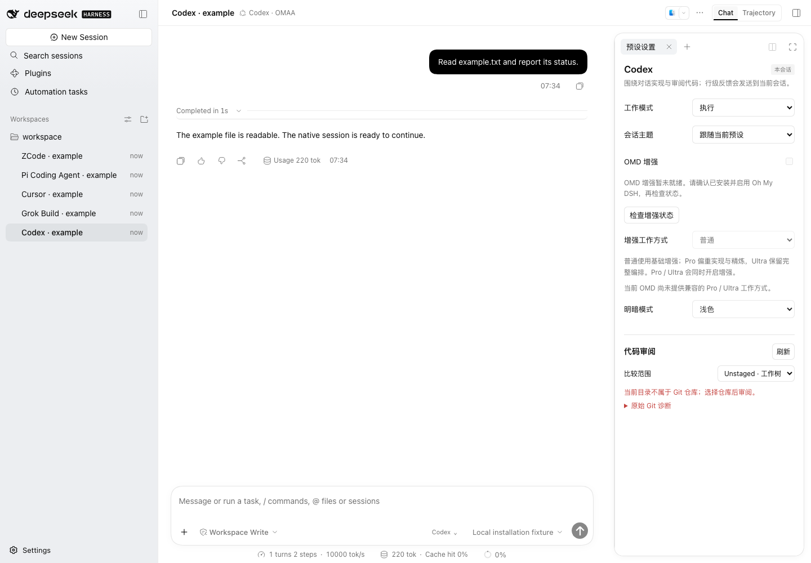

<a name="readme-top"></a>

<h1 align="center">Oh My Agents Above All</h1>

<p align="center"><strong>Work the way Codex, Grok Build, Cursor, Pi and ZCode do, inside DSH and with your own model.</strong><br>A DeepSeek Harness plugin</p>

<p align="center"><a href="README.md">简体中文</a> · <strong>English</strong></p>

<p align="center">
  <a href="https://github.com/gulagala001/oh-my-agents-above-all/releases/latest"></a>
  <a href="https://github.com/gulagala001/oh-my-agents-above-all/releases"></a>
  <a href="#readme-install"></a>
  <a href="https://github.com/gulagala001/oh-my-agents-above-all/stargazers"></a>
</p>

<p align="center"><a href="#readme-install"><strong>Get started</strong></a> · <a href="docs/frontend-workbench.md">Guide (Chinese)</a> · <a href="https://github.com/gulagala001/oh-my-agents-above-all/issues">Feedback</a></p>

<p align="center"><a href="docs/images/frontend-015/codex-light.png"><picture><source media="(prefers-color-scheme: dark)" srcset="docs/images/frontend-015/codex-dark.png"></picture></a></p>

<a name="readme-install"></a>

## Quick start

**Requires:** DSH **0.2.2-rc.2** and Node.js **24.9.0+**. OMAA uses the models and keys already configured in DSH.

### 1. Install

In DSH, open **Plugins → Add plugin** and paste:

```text
https://github.com/gulagala001/oh-my-agents-above-all/releases/download/v0.2.2-rc.2.omaa.0.17.12/oh-my-agents-above-all-0.2.2-rc.2.omaa.0.17.12.tgz
```

When your current task finishes, fully restart DSH when prompted. Your settings and conversations stay as they were. For command-line installs, upgrades and removal, see the [installation guide](docs/install_EN.md). Checksums: [SHA256SUMS](https://github.com/gulagala001/oh-my-agents-above-all/releases/download/v0.2.2-rc.2.omaa.0.17.12/SHA256SUMS).

### 2. Turn on a preset

All presets start off, so DSH looks exactly the same after installing. Open **Settings → OMAA**, turn on the presets you want, then create a session, pick **Codex · OMAA** or another preset and enter:

```text
Read this project's README and directory structure without changing anything, and list what I should confirm before starting development.
```

The session switches to that preset's way of working and theme, and reads the actual project with DSH tools.

## Five presets

Models, tools, sessions and permissions all stay with DSH. A preset changes how the AI works, the workbench and the look, so you do not need the five official clients.

| Preset | Good for |
| --- | --- |
| **Codex** | Continuous coding: review Git changes, stage or revert by file or hunk, line comments, jump to your local editor, send batched feedback for the AI to keep working |
| **Grok Build** | Plan, then execute: live command output, scheduled tasks, a message queue you can reorder and interject into |
| **Cursor** | Work by project rules: reads `.cursor/rules`, Ask and Plan modes, code review, restore files from checkpoints |
| **Pi** | Lean and controllable: few tools, step-by-step steering, switchable session branches, your own local extensions |
| **ZCode** | Reusable workflows: start one from the conversation, inspect its graph and outputs, save it and run it again by name |

Each session's theme can follow the preset, use another preset's theme or keep the default DSH look; light and dark follow DSH. Details are in the [guide](docs/frontend-workbench.md) (Chinese).

## Scope

- You never use or sign in to the official accounts or cloud services of these five products.
- Cursor checkpoints cover files the AI changed with its write and edit tools, not files changed by terminal commands.
- Pi branches share one working directory, so switching branches does not roll back files.
- Pi local extensions are all off by default; only files you add in Settings ever run.

## FAQ

<details>
<summary>I switched presets but the model stayed the same?</summary>

Presets change the way of working and the theme. Change the model in DSH's model picker; one that supports tool calls works best.

</details>

<details>
<summary>Can I use the original products' accounts or cloud features?</summary>

No. OMAA uses DSH's models and keys and never signs in to or proxies the five official clients. What each preset can do is in the [guide](docs/frontend-workbench.md).

</details>

<details>
<summary>Does upgrading or uninstalling delete conversations?</summary>

No. Upgrading keeps your profile and data. Uninstalling never deletes DSH conversations or workspace files; preferences, checkpoints and the Pi extension allowlist live in `DSH_HOME/omaa` and stay. See the [installation guide](docs/install_EN.md).

</details>

## Development and license

[Contributing](CONTRIBUTING.md) · [Architecture](docs/architecture.md) · [Sources](docs/product-sources.md)

Original code is licensed under [Apache-2.0](LICENSE). Third-party code and materials keep their own licenses and attribution; pay particular attention to the terms for the Cursor samples. See [LICENSING.md](LICENSING.md) and [THIRD_PARTY_NOTICES.md](THIRD_PARTY_NOTICES.md).

When reporting a problem, include your DSH and plugin versions, the preset, the steps, and what you expected versus what happened. Remove personal data from logs and screenshots first: [Issues](https://github.com/gulagala001/oh-my-agents-above-all/issues).
