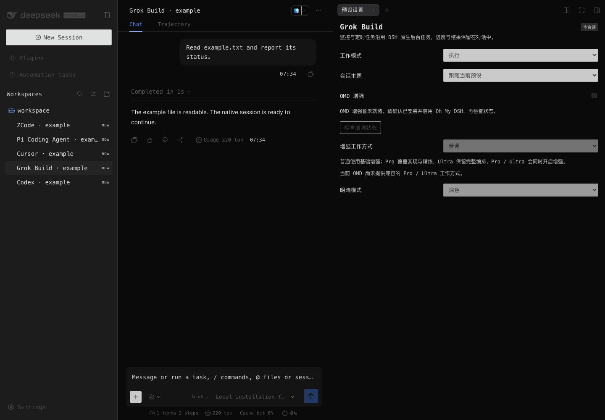

# OMAA 使用指南

[中文首页](../README.md) · [安装与更新](install.md) · [架构](architecture.md)

## 开启预设

装好后所有预设默认关闭，DSH 的会话、工具和主题保持原样。打开 **设置 → OMAA**，在 **代理预设** 里按需开启 Codex、Grok Build、Cursor、Pi 或 ZCode。开启后新建会话时就能选 **Codex · OMAA** 这类预设；DSH 自己的默认预设不会被替换。

关掉某个预设时，它的工具、控制栏和主题会一起撤下，历史会话和个人设置都留着。用这个预设的任务还在跑或排队时，不能关闭。

设置页还有 **当前会话**、**Pi 本地扩展**、**版本与更新** 和 **更多设置** 几组。

## 五个预设

模型、工具、会话和权限都由 DSH 负责，预设改变的是 AI 的工作方式、可用的工作台和界面外观。不需要装这五个产品的官方客户端，也用不到它们的账号或云端服务。

| 预设 | 适合做什么 | 主要功能 |
| --- | --- | --- |
| Codex | 连续的代码工作 | Git 改动审阅（未暂存、已暂存、提交、分支、上一轮），按文件或代码块暂存和撤回，行批注，跳到本机编辑器，批量反馈让 AI 接着改 |
| Grok Build | 先计划再执行 | 实时查看命令输出，定时任务，输入框上方的消息队列可以排序、编辑、插话和立即发送 |
| Cursor | 按项目规则工作 | 读取 `.cursor/rules` 里的规则，Ask 和 Plan 模式，独立的代码审阅，文件检查点恢复 |
| Pi | 精简、可控的执行 | 精简的默认工具，逐条插话，会话分支导航，用户指定的本地扩展 |
| ZCode | 可复用的工作流 | 用对话发起工作流，查看执行图和产物，保存后按名字再次运行 |

每个预设的实现细节见[架构](architecture.md#各预设的来源与适配)。

## 审阅代码改动

**Codex**：在右栏选择比较范围，按文件或代码块暂存、取消暂存或撤回。行批注重启后还在。可以单条或批量把批注发给 AI 修改，已阅、已发送和已解决分开记录。工作区不是 Git 仓库时，会显示简短说明，诊断详情可以展开查看。

**Cursor**：**Cursor 代码审阅** 支持工作区、暂存、提交、分支和会话回合等范围，可以切换并排或统一视图。行批注保存在本机，批量反馈后由当前会话接着改。Find Issues 只读检查，不会改文件。

## Cursor 文件检查点

Cursor 会话里 AI 用写入和编辑工具改过的文本文件会被记录下来。打开检查点面板，点 **刷新检查点**，选择要恢复的文件。

- 恢复只动选中的文件，对话消息都保留。
- 恢复前会检查文件是否被别人改过。有冲突时不会覆盖，会列出冲突的文件。
- 会话正在运行时不能恢复。
- 通过终端命令改的文件、二进制文件、超过 2 MiB 的文件不在记录范围内。

## Pi 分支和本地扩展

Pi 会话可以从任意已完成的回合分出新分支，在分支树里切换。所有分支共用同一个工作目录，切换分支不会回退文件。

本地扩展默认一个都不启用。到 **设置 → OMAA → Pi 本地扩展** 加入你信任的 TS 或 JS 文件（填绝对路径），之后在 Pi 会话里就能用它提供的事件和斜杠命令。接口说明见 [Pi 本地扩展](products/pi-extensions.md)。

## ZCode 工作流

在 ZCode 会话里描述要做的事，AI 会生成并运行工作流。工作台里可以看执行图、Actor 和产物，产物按钮支持左右方向键和 Home、End。满意的工作流可以保存，之后按名字再次运行。

## 主题

每个会话可以在 **会话主题** 里选择 **跟随当前预设**、换成另一个预设的主题，或者用 **DSH 默认外观**。深浅色跟随 DSH 的设置。Cursor 预设沿用 DSH 的配色。

主题只影响 OMAA 自己的面板和所选会话。开启"减少动态效果"后，OMAA 的面板、工作流图和工具卡片也会一起减少动画。

## 界面截图

以下截图来自 DSH Web 里的 OMAA，使用合成的示例项目。

| 预设 | 浅色 | 深色 |
| --- | --- | --- |
| Codex | [查看](images/frontend-015/codex-light.png) | [查看](images/frontend-015/codex-dark.png) |
| Grok Build | [查看](images/frontend-015/grok-light.png) | [查看](images/frontend-015/grok-dark.png) |
| Cursor | [查看](images/frontend-015/cursor-light.png) | [查看](images/frontend-015/cursor-dark.png) |
| Pi | [查看](images/frontend-015/pi-light.png) | [查看](images/frontend-015/pi-dark.png) |
| ZCode | [查看](images/frontend-015/zcode-light.png) | [查看](images/frontend-015/zcode-dark.png) |

## 版本与兼容

当前版本 OMAA 0.17.11 对应 DSH `0.2.2-rc.2`。其他 DSH 版本请到 [Releases](https://github.com/gulagala001/oh-my-agents-above-all/releases) 找对应的包，版本不一致的包不要混装。升级 DSH 前，先看新版本有没有对应的 OMAA。

同时装了 OMD 时，OMAA 的更新检查会找与当前 DSH 版本匹配的最新发行，安装前核对校验值，不会降级。电脑操作（Computer Use）由 OMD 或 OpenCU 提供，权限和平台支持见它们的说明。中途装上或卸掉 OMD 后，需要重新加载 profile。

Windows 和 Linux 上能用到哪些系统能力，取决于 DSH 和所用工具，不随主题变化。

## 数据

偏好设置、文件检查点和 Pi 扩展白名单保存在 `DSH_HOME/omaa`。卸载插件不会删除这些数据，也不会删除 DSH 会话和工作区文件。
